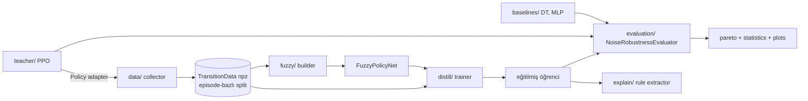

# Mimari

## Katmanlar ve veri akışı

## FuzzyPolicyNet iç akışı
`obs → standardize → MF (lower, upper) → t-norm → (f_lo, f_up) ; TSK consequent y_r ; reducer → action`
- T1 ≡ `gaussian` MF + `weighted_average`. IT2 ≡ `it2_*` MF + `nie_tan | bounds_mixing`. **Aynı sınıf**, farklı enjekte edilen bileşenler → adil karşılaştırma, aynı parametre/kod yolu.
- **Kural-bazlı MF** (R×D Gauss): kural sayısı doğrudan seçilir (grid'deki K^D patlaması yok; LunarLander D=8) ve her kural bağımsız okunabilir.
- IT2 MF: `lower ≤ upper` yapısal olarak garanti (σ_up = σ(1+softplus ρ); uncertain-mean'de düz tepe).
- FOU → 0 iken IT2, T1'e çöker (test ile doğrulanır) → "IT2 T1'in genellemesidir" argümanı.

## Tasarım desenleri
| Desen | Yer | Gerekçe |
|---|---|---|
| Strategy | `tnorm`, `type_reduction`, `initializers`, `losses`, `regularizers`, `augment` | Deney faktörü = tak-çıkar bileşen (ablasyonlar config'ten) |
| Registry + Factory | `core/registry.py`, `envs/factory.py` | Yeni MF/reducer eklemek mevcut kodu değiştirmez (OCP) |
| Builder | `fuzzy/builder.py` | Karmaşık nesne kurulumu (init verisi, config) tek yerde |
| Adapter | `teacher/adapter.py`, `evaluation/policy_adapters.py` | SB3/torch/sklearn → ortak `Policy` |
| Decorator | `envs/wrappers.py` | Gürültü, ortama şeffaf eklenir |
| Observer | `distill/callbacks.py` | Early stop / log / checkpoint trainer'dan ayrık |
| Composite | `CompositeRegularizer` | Çoklu regularizer tek çağrı |
| Facade | `experiments/pipeline.py` | Scriptler tek giriş noktası kullanır |
| Command | `experiments/ablation.py` | Ablasyon = adlandırılmış override kümesi |
| Dependency Injection | `DistillationTrainer`, `FuzzyPolicyNet` | Test edilebilirlik |

## SOLID eşlemesi
- **S**: Her katman/sınıf tek iş (örn. `RuleFiringLayer` yalnız t-norm uygular; `FuzzificationLayer` yalnız MF).
- **O**: Yeni MF/t-norm/reducer/loss → yeni sınıf + `@register`; çekirdek dokunulmaz.
- **L**: T1 MF'ler de `(lower, upper)` döner; `Reducer`lar birbirinin yerine geçer; `Policy` protokolünü teacher, fuzzy, DT, MLP aynı şekilde sağlar.
- **I**: Küçük arayüzler: `Policy` (act), `Explainable` (n_rules, extract_rules) ayrı.
- **D**: Trainer/Evaluator somut modellere değil `Policy`/`nn.Module`/`DistillLoss` soyutlamalarına bağlı.

## Temiz kod kuralları
Tip ipuçları, `ruff` (line-length 100), saf metrik fonksiyonları (I/O yok), config tek doğruluk kaynağı,
scriptlerde sıfır mantık, tüm rastgelelik `seed_everything` + seed'den türetilen RNG'ler.
